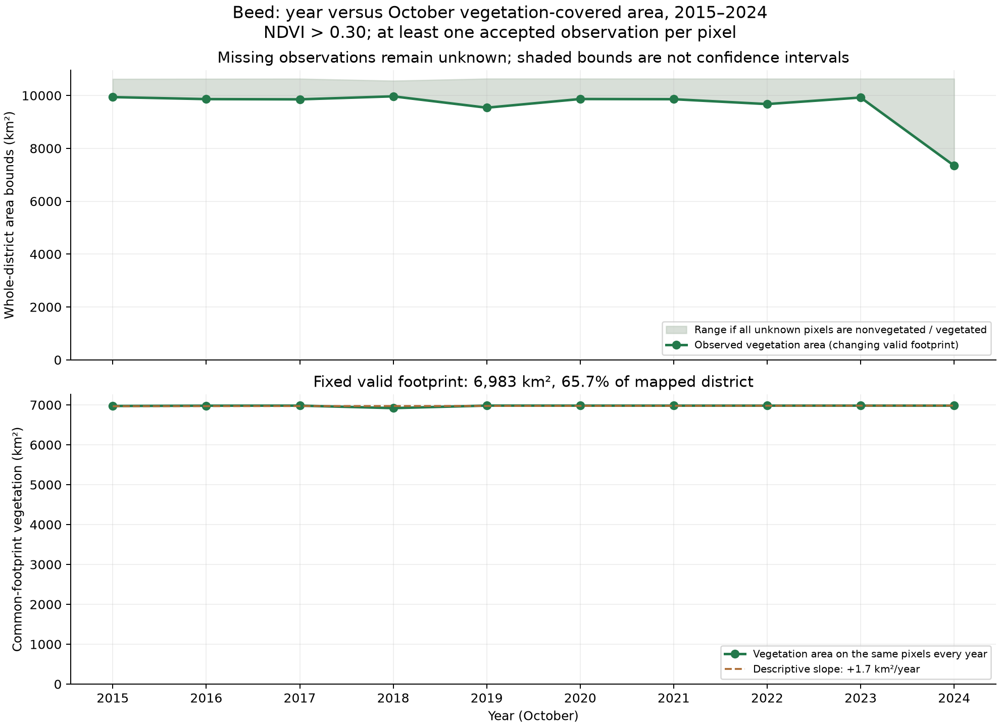
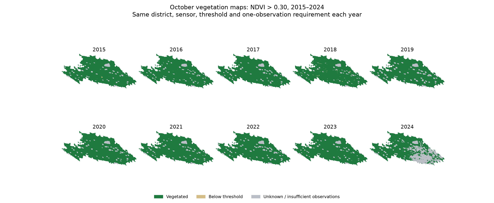
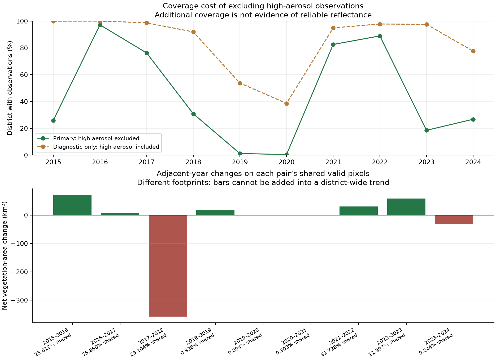

# Ten Octobers of vegetation cover in Beed, Maharashtra

**Did vegetation cover decrease each year in a drought-prone district? No.** On the same 6,983.3 km² of Beed observed in all ten Octobers from 2015 through 2024, vegetation area fell four times and rose five times. At the primary threshold, 99.1–100% of that footprint qualified as vegetated. October 2018 had the smallest area and the lowest mean greenness. The footprint covers 65.7% of the mapped district. The remaining land has insufficient observations to answer the ten-year question on the same basis. [Assignment report](results/assignment/assignment_report.md) · [Annual measurements](results/assignment/year_vs_vegetation_area.csv)



## What the assignment asked

> Search and find a long-term drought-prone area in India. Download satellite images over a 10year period for a post-monsoon month (October, for example). Compute vegetation cover in the study area and plot year versus area of vegetation cover and see if it is low or decreasing each year (loss of vegetation cover is one indicator for drought-prone areas).

The accompanying instructions permit built-ins for image reading, writing, display and selected numerical operations. They encourage suitable open imagery with ground truth and indicate when four or more bands including infrared are appropriate. The core assignment uses seven spectral bands, computes the index, mask, classification and area locally, and plots ten October values. The extended rainfall, crop and classifier studies answer additional questions. **The requested image analysis and plot are complete.** The evidence for historical drought, image interpretation and field-measured vegetation each has a different role below.

**Why Beed?** The district disaster management plan documents summer drought in 2012–13, 2014–15, 2015–16, 2018–19 and 2019–20. These records establish recurrent exposure. Their seasons and spatial detail preclude treating them as labels for individual October pixels. We used a single official Survey of India district polygon, LGD 523, for the full decade. Historical boundary equivalence is an assumption. [District plan, section 2.3.3, p. 61](data/assignment/sources/beed_ddmp_2022_2023.pdf) · [Page image](tmp/pdfs/beed_drought_history.png) · [Study boundary](data/study/ancillary/soi2025_beed.geojson)

## The primary result, year by year

The third column counts vegetation wherever that year has valid observations. The fourth answers the trend question by counting **the same 32,532 pixels every year**. The final column measures greenness continuously on those pixels. It retains changes a yes/no threshold can hide. [Full-precision table, coverage bounds and pixel counts](results/assignment/year_vs_vegetation_area.csv)

| October | Valid district area (%) | Vegetated on observed land (km²) | Vegetated on fixed footprint (km²) | Mean NDVI on fixed footprint |
| --- | ---: | ---: | ---: | ---: |
| 2015 | 93.6 | 9,939.1 | 6,973.4 | 0.508 |
| 2016 | 92.8 | 9,862.7 | 6,980.5 | 0.569 |
| 2017 | 92.7 | 9,853.7 | 6,982.4 | 0.611 |
| 2018 | 94.5 | 9,968.3 | 6,920.4 | 0.439 |
| 2019 | 89.7 | 9,537.9 | 6,983.3 | 0.620 |
| 2020 | 92.8 | 9,866.1 | 6,982.4 | 0.631 |
| 2021 | 92.7 | 9,859.5 | 6,982.0 | 0.610 |
| 2022 | 91.0 | 9,674.9 | 6,982.2 | 0.614 |
| 2023 | 93.3 | 9,922.6 | 6,982.6 | 0.591 |
| 2024 | 69.1 | 7,345.2 | 6,982.0 | 0.632 |

**2018 provides the clearest example of threshold sensitivity.** Its mean NDVI was 0.439, rising to 0.620 in 2019. In 2018, 99.1% of the fixed footprint exceeded 0.30, but only 66.3% exceeded 0.40. The October three-month rainfall index (SPI-3) for the official district was −1.69 in 2018 and +1.42 in 2019. This is consistent with drier conditions in 2018. Crop timing, irrigation, land cover and within-pixel mixtures can also affect greenness. No local cutoff for declaring a district drought from vegetation area has been calibrated. [Threshold results](results/assignment/area_all_sensitivities.csv) · [District rainfall and SPI](results/study_corrected/rainfall_spi.csv)

**2024 shows why the denominator matters.** The area observed as vegetated fell from 9,922.6 km² in 2023 to 7,345.2 km² in 2024 as valid district coverage fell from 93.3% to 69.1%. Over their fixed ten-year footprint, the corresponding areas were 6,982.6 and 6,982.0 km². Assigning all missing pixels to bare land would create an apparent loss of thousands of square kilometres. The saved lower and upper bounds show the range allowed by missing coverage. [Annual area and coverage](results/assignment/year_vs_vegetation_area.csv)

**Which year limits the ten-year comparison?** In this review we removed each October in turn and rebuilt the intersection from the observation-count rasters. Removing 2024 increased comparable coverage from **65.66% to 86.37%**. Exactly 10,263 pixels were usable in every other year and missing only in 2024. Omitting any other single year raised coverage to at most 66.52%. The primary plot retains all ten years. [Coverage for every omitted year](results/assignment/coverage_by_omitted_year.csv) · [Calculation](pipeline/assignment/footprint_review.py)

### How the area was calculated

1. Download all 43 NASA Terra MOD09A1 Collection 6.1 eight-day composites capable of containing an October observation in the ten years. Keep seven reflectance bands, quality flags and the selected observation day. A composite can start in September and contain an October pixel. Accept each pixel by its actual date.
2. Project the official polygon onto the native sinusoidal grid and include pixels whose centres fall inside. The native spacing is 463.313 m, giving 0.214659 km² per pixel. The centre-based mapped area is 10,635.69 km². The vector area is 10,603.22 km². The grid, Earth model and edge convention account for the difference.
3. Decode quality flags, retain clear eligible land observations, and compute NDVI as `(near infrared − red) / (near infrared + red)`. Average the accepted NDVI values at each pixel for October. Count the whole pixel as vegetation where that mean exceeds 0.30. The measure is classified pixel area. A partially green field within one coarse pixel cannot be assigned a fractional canopy area from this rule.
4. Count valid pixels and vegetation pixels separately, then multiply the vegetation count by native pixel area. We initially required two observations per October. Only 4.24% of Beed passed that rule in every year. The documented amendment uses at least one observation for the primary result. Both observation rules and thresholds of 0.20, 0.30 and 0.40 remain available.
5. Compare adjacent years on the fixed footprint. The primary end-to-start difference was +8.6 km². The least-squares slope was +1.67 km²/year. None of the six settings showed a decrease every year. These estimates describe ten observations on a nonrandom footprint. They establish neither a statistically significant increase nor a long-term district drought trend. [Protocol and amendment](results/assignment/protocol.md) · [Original two-observation run](results/assignment/initial_min2_audit/) · [Trend calculations](results/assignment/trend_summary.json)

The course pipeline uses handwritten loops and arithmetic for projection, polygon masking, quality checks, monthly NDVI, classification, area and trend. Rasterio handles image I/O, NumPy holds arrays, and Matplotlib renders figures. Earth Engine supplied source pixels. Independent validation checked 43 source hashes, raster accounting and 90 sampled pixel-year calculations. [Code and run instructions](pipeline/assignment/README.md) · [Validation record](results/assignment/validation.json)



## What we tried, in order

| Stage | What we did | What we learned |
| --- | --- | --- |
| 1. Literature and proposal | Read the Taji & Keskar Beed rainfall study, the Somni et al. post-monsoon Marathwada study and the Andure et al. Beed ML paper. Screened Kulkarni et al. as additional prior work. | The studies use different targets. In particular, predicting VHI from the VCI and TCI used to construct it can reconstruct the formula. A high score on that task supplies little evidence of forecast skill. [Paper-by-paper review](literature/notes/paper_review.md) · [Literature matrix](literature/literature_matrix.md) · [Original proposal](docs/project_proposal.md) |
| 2. Andure reconstruction and audits | Rebuilt October vegetation and temperature condition indices (VCI, TCI) and their equally weighted vegetation health index (VHI). Tested historical reference support, eight-/sixteen-day composite timing and QA flags. | October 2020 VHI was 91.43 on 26.17% spatial support. In October 2024 it was 106.98 on just 0.97%. A value above 100 is possible against fixed historical extrema. Coverage and the choice of actual observation date materially change interpretation. [Pilot](results/andure/pilot_review.md) · [Date audit](results/andure/date_audit_review.md) · [Quality flags](results/andure/detailed_quality_review.md) |
| 3. Controlled satellite and rainfall study | Compared four policies, from strict composite-start screening (A), to per-pixel dating (B), screened marginal quality (C), and daily temperature with the C screen (D). Retrieved 120 comparison rows, 288 historical rows and 528 monthly CHIRPS rainfall rows. Calculated SPI at 1, 3, 6 and 12 months. | Median VHI coverage over the 15 evaluation months was about 26%, 39%, 83% and 83% for A–D. Improved coverage alone cannot establish accuracy. 8.56% of the older GAUL polygon lay outside the official district. Results were downloaded through checkpointed Earth Engine requests after queued Drive exports stalled. [Controlled study](results/study/research_results.md) · [Boundary audit](results/study/boundary_validation.json) |
| 4. Official boundary, cropland and crop outcomes | Repeated the study on the official polygon and with fractional cropland weights from 2021 WorldCover. Retrieved 1,056 rows across three datasets. Harmonized 125 crop records from 25 agricultural-year reports. Fitted historical relationships for rabi jowar, wheat and chickpea on 2001–2019, then evaluated 2020–2024. | Previous-year yield gave lower mean absolute error than every one of 30 tested indicator calibrations. All 15 held-out crop-years were above their fitted historical yield trend, so the test contained zero below-trend loss cases. Repeated published crop areas, estimate revisions, season alignment and a fixed 2021 crop map constrain interpretation. The two additional harmonized crops were soybean and cotton. The official rainfall grid and satellite cropland weights have different spatial support. [Corrected study and crop results](results/study_corrected/research_results.md) · [Held-out predictions](results/study_corrected/test_predictions.csv) |
| 5. Ten-year course assignment | Downloaded multispectral MODIS images, ran the local area computation and retained annual imagery, maps, tables and all six sensitivity settings. | High measured October cover at NDVI > 0.30, with a visible 2018 dip and no year-on-year decline across the decade. This stage directly answers the course question. [Completed assignment](results/assignment/assignment_report.md) |
| 6. Landsat refinement | Downloaded 67 Landsat 8 scenes as 573 native 30 m tiles (6.05 GB). Applied reflectance scale and offset, masked poor observations, deduplicated overlapping scenes by date, and used handwritten C++ loops to create ten October composites. Generated area, NDVI distributions and pairwise gain/loss maps. | The finer imagery resolved local patterns. Annual valid coverage ranged from 0.41% in 2020 to 97.2% in 2016. Only 79 pixels (0.0711 km², 0.000671% of Beed) passed in every year. The 1,050 independent sampled pixel-year checks support the calculation. The coverage is insufficient for a district-wide ten-year conclusion from Landsat. [Landsat report](results/landsat/landsat_report.md) · [Tile manifest](data/landsat/download_manifest.json) · [Validation](results/landsat/validation.json) |
| 7. Independent-image classifier pilot | Screened an open label archive, acquired October 2022 Sentinel-2 reference imagery, interpreted the sites blind to the model outputs, and tested a handwritten three-nearest-neighbours classifier against NDVI on geographically held-out sites. | Both rules agreed with almost all interpretable eastern sites. One site accounts for the entire difference. This pilot measures agreement with one image interpreter and leaves district accuracy, other years and forecasting open. [Protocol](results/reference/protocol.md) · [Results](results/reference/evaluation.json) |

**What Landsat adds.** The comparable area depends on the pair of years. The 2016–17 pair gained a net 5.823 km² across 75.86% of Beed. The 2021–22 pair gained 30.488 km² across 81.73%. The 2017–18 pair lost 358.291 km² across 29.10%. The 2019–20 pair shared just 528 pixels. Gains and losses are threshold crossings on different footprints, so summing them would misstate a decade of change. Permitting high-aerosol observations in a diagnostic raised ten-year common coverage to 13.44%. Their reflectance quality remains uncertain. MODIS also excludes water while Landsat retains eligible water. Dates, spatial resolution, masking and land classes all need matching before a direct sensor comparison. [Pairwise changes](results/landsat/pairwise_changes.csv) · [Aerosol diagnostic](results/landsat/aerosol_coverage_diagnostic.csv)



### What the machine learning experiment actually tested

October 2022 had 88.9% valid Landsat coverage. The CropHarvest release contained 113,893 features, of which only five intersected Beed. All five had a September 2016 collection date and crop/non-crop labels. None establishes live vegetation at a site in October 2022. We therefore obtained Sentinel-2 imagery close in time to an accepted Landsat acquisition and used true-colour and infrared views to interpret the central 30 m footprint. [CropHarvest screen](data/reference/cropharvest_screen.json) · [Public label release](https://zenodo.org/records/10251170) · [Sentinel-2 surface reflectance](https://developers.google.com/earth-engine/datasets/catalog/COPERNICUS_S2_SR_HARMONIZED)

Of 64 selected sites, 14 lacked qualifying Sentinel-2 imagery within three days and seven had ambiguous cover. One AI reviewer interpreted the images with opaque site IDs. The 43 usable sites comprised 18 western training sites and 25 eastern test sites. The closest eligible train–test pair was 16.6 km apart. The classifier used green, red, near-infrared and two shortwave-infrared Landsat bands, standardized on the training sites. The NDVI comparison used the same test sites and the original 0.30 cutoff. [Sampling and interpretation protocol](results/reference/protocol.md) · [Site and source records](results/reference/sites.json) · [Interpretations, including exclusions](results/reference/interpretation.csv)

| Method | Green sites detected (of 13) | Other sites detected (of 12) | Total agreement | Balanced accuracy |
| --- | ---: | ---: | ---: | ---: |
| NDVI > 0.30 | 13 | 11 | 24/25 | 95.8% |
| Three nearest neighbours | 13 | 12 | 25/25 | 100% |

The sole difference was site **P31**, interpreted as exposed ground. Its monthly Landsat NDVI was 0.346. The threshold classified it as green and the classifier as other. Nine of the twelve non-green test sites were water. Sampling deliberately enriched both sides of the threshold, ambiguous sites were excluded, and one Sentinel-2 date represents a monthly Landsat composite imperfectly. Consequently, one more agreement in one October cannot establish a general ML advantage. No field visit or second human interpretation has been recorded. [Site measurements](results/reference/samples.csv) · [Per-site predictions](results/reference/held_out_predictions.csv) · [Numerical evaluation](results/reference/evaluation.json) · [Blind reference panels](results/reference/review/)

## Figure guide

The course figures above show the primary answer and its geography. The remaining figures are grouped by the question they address. All links open the saved study outputs.

| Question | Figures |
| --- | --- |
| What did the October imagery and threshold choices look like? | [MODIS false-colour gallery](results/assignment/october_false_colour.png) · [Six threshold and observation settings](results/assignment/threshold_sensitivity.png) |
| What did 30 m Landsat resolve, and when was coverage adequate? | [False-colour gallery](results/landsat/october_false_colour.png) · [Vegetation maps](results/landsat/october_vegetation.png) · [Annual area](results/landsat/year_vs_vegetation_area.png) · [NDVI and coverage](results/landsat/ndvi_and_coverage.png) · [NDVI distributions](results/landsat/ndvi_distribution.png) · [Quality and pairwise change](results/landsat/quality_and_pairwise_changes.png) |
| Why did the original VHI results need revision? | [Pilot coverage](results/andure/pilot_coverage.png) · [Boundary comparison](results/study/boundary_comparison.png) · [Candidate masks](results/study/candidate_masks.png) · [Four QA policies](results/study/controlled_comparison.png) |
| How did rainfall and crop outcomes compare? | [Rainfall and SPI](results/study/rainfall_spi.png) · [Rainfall distribution fit](results/study/spi_gamma_qq.png) · [Corrected comparison](results/study_corrected/corrected_comparison.png) · [Cropland weights](results/study_corrected/cropland_weighting.png) · [Corrected rainfall distribution fit](results/study_corrected/spi_gamma_qq.png) · [Yield and indicator history](results/study_corrected/yield_indicator_history.png) · [Held-out yield errors](results/study_corrected/holdout_error_comparison.png) |
| What evidence was used to label the ML sites? | [Panel 1](results/reference/review/blind_1.png) · [Panel 2](results/reference/review/blind_2.png) · [Panel 3](results/reference/review/blind_3.png) · [Panel 4](results/reference/review/blind_4.png) |

## Repository map and reproduction

The [file-by-file inventory](docs/file_inventory.tsv) lists each project file in this local checkout, including ignored raster tiles, ancillary archives, QA logs, checkpoints, source snapshots, PDFs, figures and tables. Each row gives the path, Git status at review (tracked, untracked or ignored), size, SHA-256, available manifest comparison and a format-specific description. The [audit summary](docs/file_audit.json) identifies omissions and changes relative to execution-time manifests. Environment packages, Git internals, compiler and interpreter caches, operating-system metadata and the inventory's own two outputs are excluded. A matching hash establishes byte identity with the corresponding manifest. The stage reports record the pixel and table checks.

| Location | Contents and entry point |
| --- | --- |
| [literature](literature/) and [docs](docs/) | [Source paper inventory](literature/papers/inventory.json), annotated reviews, proposal, dated handoffs and the file audit. Dates on older plans matter because later stages resolved earlier access and data gaps. |
| [pipeline/andure](pipeline/andure/) and [results/andure](results/andure/) | Early Earth Engine experiments, retained input extracts, quality/date audits and reports. Some early extracts transcribe reported values from an earlier run. See each audit for its source. |
| [pipeline/study](pipeline/study/README.md), [data/study](data/study/) and [data/study_corrected](data/study_corrected/) | Earth Engine retrieval, ancillary sources, crop extraction and harmonization, original and corrected geography, and rainfall or impact analysis. [Original outputs](results/study/) · [Corrected outputs](results/study_corrected/) |
| [pipeline/assignment](pipeline/assignment/README.md) and [results/assignment](results/assignment/) | Course analysis, download and validation commands, primary area table, maps, evidence of drought history and original observation-rule audit. |
| [pipeline/landsat](pipeline/landsat/README.md) and [results/landsat](results/landsat/) | Finer-resolution acquisition, scalar image kernel, quality audits, coverage, transitions and report. The large local TIFFs and national boundary archive are excluded from ordinary Git distribution. The extracted Beed polygon and Landsat download manifest are available. |
| [pipeline/reference](pipeline/reference/) and [results/reference](results/reference/) | Sentinel-2 retrieval, blind panels and interpretations, per-site features, supervised classifier, predictions and scores. |

From the repository root with the project virtual environment, these commands run the existing test suites and reproduce the classifier scores from the saved site measurements. The footprint review reads the local MODIS observation rasters. For native-image recomputation, use the stage-specific commands and dependency files linked above. Reacquisition from Earth Engine requires an authorized project. Reading the reports, figures and feature-based evaluation works offline.

```sh
for stage in andure assignment landsat study
do
  .venv/bin/python -m unittest discover -s "pipeline/$stage" -p 'test_*.py' -q || break
done
.venv/bin/python pipeline/assignment/footprint_review.py
.venv/bin/python pipeline/reference/evaluate.py --from-samples
```

All 38 existing tests passed in the 18 November 2026 audit (14 reconstruction, four course, five Landsat and 15 controlled/corrected study tests). The classifier was also evaluated from the local imagery. For a fresh Landsat reconstruction, use a **separate working copy** and move the saved `results/landsat/qa` directory aside in that copy before running the analysis. The current resume check trusts a matching annual QA signature even when the generated TIFFs are absent. Reading saved results does not require this workaround. [Landsat analysis](pipeline/landsat/analyze.py) · [MODIS execution manifest](results/assignment/execution_manifest.json) · [Landsat execution manifest](results/landsat/execution_manifest.json)

## Completion plan

| Priority | Work remaining | Deliverable and criterion for completion |
| --- | --- | --- |
| 1. Course submission | Assemble the existing evidence in the instructor's required format. Lead with the drought record, district, dates, band choice, handwritten method, fixed-area plot, 2018 result and 2024 coverage example. Include the threshold-sensitivity figure and a short limitations paragraph. | The technical report, tables and figures already exist. Final packaging depends on the rubric or submission format. State the extent of reference evidence explicitly if the course requires ground truth. [Ready-to-use report](results/assignment/assignment_report.md) |
| 2. Independent reference evidence | Seek dated field observations if required by the rubric. For image-based validation, have at least two independent human reviewers label the same sites blind, keep ambiguous/mixed cover visible, report agreement and adjudicate disagreements. Sample more exposed and mixed land, more geographic blocks and additional years. | Publish the dated label set and exclusions. Reserve untouched locations and years for a final comparison. Report confusion matrices and uncertainty. For district accuracy, use a probability sample and area-appropriate weights. This is the largest gap in any classification-accuracy claim. |
| 3. Stronger spatial interpretation | Match dates and eligible land/water masks in well-covered years such as 2016 and 2022. Aggregate 30 m classified fractions inside MODIS cells, retain common clear coverage, and check where threshold, vegetation density and mixed pixels drive disagreement. | A paired cross-sensor table and disagreement map with denominators, dates and excluded area. This would explain measurement differences and improve the interpretation of the near-saturated 0.30 result. |
| 4. Reproducible handover | Exercise the entire raster rebuild in a fresh copy, including recovery after an interrupted run. Check that each required annual TIFF exists and is readable before accepting a cached QA marker. | A clean reconstruction reproduces the area tables from the source inventory and regenerates a deliberately missing product. Preserve the original execution manifests for comparison. |
| 5. Optional government-facing forecast | Define an exact target and decision date, for example the probability that next month's district SPI-3 will be ≤ −1. Start with several districts and historical inputs available **as of each issue date**. Compare with climatology and persistence using rolling years and entirely held-out districts. Track missing data, release lag, calibration and false alerts. | A district briefing with a dated probability, coverage, uncertainty and a field-verification trigger. Report held-out skill and the cases where the system must abstain. A region-input service depends on those tests. The repository currently supplies retrospective indicators and one-district evidence. |

The scientific contribution is the decade-long comparable area estimate, the demonstration of how missing observations can mimic vegetation loss, and the independent checks on what higher resolution and a classifier add. For an assignment presentation, the 2018 dip and the apparent 2024 drop make that distinction visible in the actual data.
