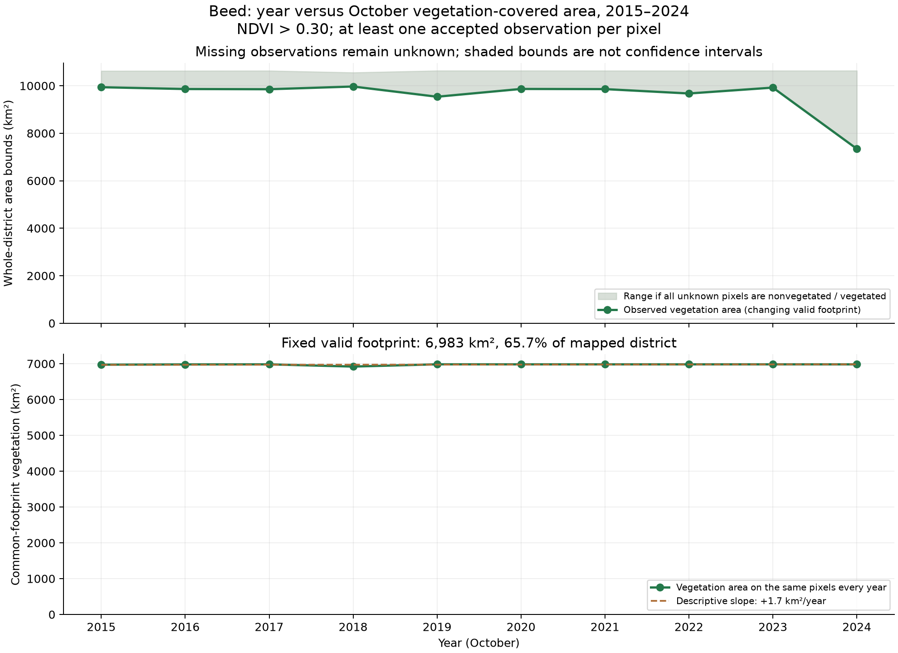
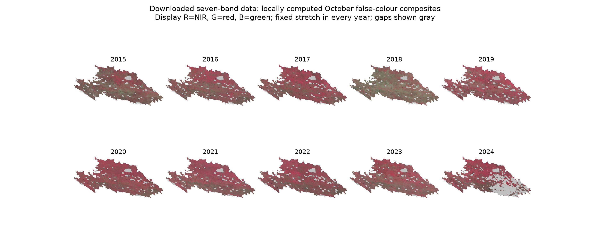
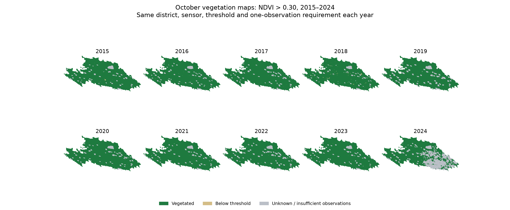
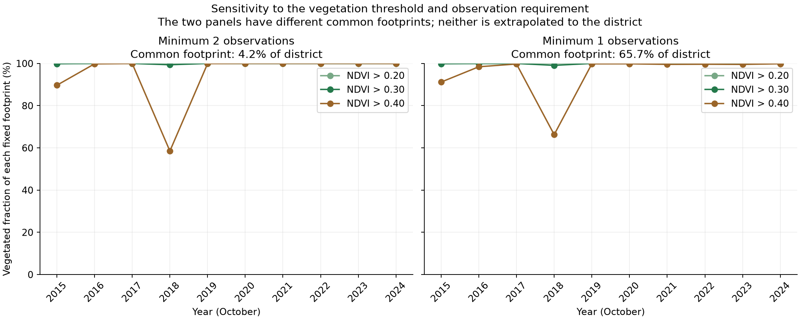

# Ten-year October vegetation-cover study: Beed, India

## Direct answer to the problem statement

The completed analysis uses **October 2015–2024**, ten years of the same satellite product over the same Beed district boundary. **Does the comparable vegetation area decrease every year? No.** There are **4 decreases and 5 increases** across the nine adjacent-year changes. The descriptive common-footprint slope is **+1.7 km²/year**. The observed end-to-start difference is **+8.6 km²** on that fixed footprint. This is a small change: **99.1–100% of the common footprint is classified as vegetated in each year**, so area is effectively stable at this threshold. This binary classification is nearly saturated and can miss changes in vegetation density or condition. These statements are descriptive, not significance tests.

The lowest common-footprint vegetation area occurs in **October 2018: 6,920.4 km² (99.1%)**; the highest occurs in **October 2019: 6,983.3 km² (100.0%)**. The 2018 minimum is relative to the other nine October observations; vegetation area is not low as a fraction of this common footprint at NDVI > 0.30. There is no calibrated absolute district-level drought cutoff.

The common footprint covers **6,983.3 km² (65.7% of the mapped district)**. It is not the entire district and is not extrapolated to missing pixels. Requiring observations in every year selects a nonrandom subset of locations, so its trend need not represent the unobserved district. The full-district figure retains bounds for unobserved areas, so cloud gaps cannot silently appear as vegetation loss.

## Why Beed is a suitable drought-prone study area

The [official Zilla Parishad introduction](https://www.zpbeed.gov.in/en/about-department/introduction/) identifies Beed as drought-prone. The district's **2022–2023 Disaster Management Plan**, section 2.3.3, printed/PDF page 61, records summer drought in 2012–13, 2014–15, 2015–16, 2018–19 and 2019–20, including district-wide agricultural drought in four of those periods. It cites the Natural Calamity Branch, Collector Office, Beed. The PDF was downloaded and page 61 visually checked. [Official plan](https://cdnbbsr.s3waas.gov.in/s36143cc48107351648de16d8367dc5db4/uploads/2025/03/20250306517027863.pdf), linked from the [state disaster-management authority](https://sdma.maharashtra.gov.in/en/district-disaster-management-plan-ddmp/).

This is independent ground-based administrative **context for selecting the drought-prone region**. It is not pixel-level vegetation ground truth and does not label each October as drought/non-drought. No vegetation-class accuracy percentage is claimed. Long-term drought exposure does not require vegetation cover to decline monotonically in every chosen year.

## Satellite images actually downloaded

**43 source GeoTIFFs** were downloaded from NASA **MOD09A1 Collection 6.1 Terra surface reflectance**. Every source contains **seven spectral bands** plus QA, StateQA and selected-pixel DayOfYear. Band 1 is red; band 2 is near-infrared; bands 3/4 are blue/green; bands 5–7 provide infrared information. These are multispectral inputs, not RGB-only screenshots. Product DOI: [10.5067/MODIS/MOD09A1.061](https://doi.org/10.5067/MODIS/MOD09A1.061); [band/QA documentation](https://developers.google.com/earth-engine/datasets/catalog/MODIS_061_MOD09A1).

NASA supplies atmospherically corrected eight-day products, which select an observation per pixel. We downloaded all products potentially containing October observations, including late-September starts when appropriate, and accepted pixels only when their supplied observation date falls inside October. Four source composites contribute in most years and five in leap years. All image IDs, dates, byte sizes and SHA256 hashes are retained.

The district boundary is the previously acquired official Survey of India ABDB2025 polygon, LGD 523. It is fixed across all years; exact historical boundary equivalence is not claimed. The native MODIS spacing is **463.312716528 m**, so pixel area is **0.214658673 km²**, not the rounded nominal 500 m squared. Pixel-centre rasterization yields **10,635.69 km²** on the MODIS sphere. The earlier ellipsoidal equal-area vector estimate is 10,603.22 km²; the small difference reflects the spherical grid and boundary discretization. Native spherical CRS metadata is explicit in processed images; original downloaded TIFFs are preserved, including their imperfect CRS tags. No resampling was used to generate the spectral input grid.

## Explicit computation and built-in-function restriction

Core code: `pipeline/assignment/vegetation.py`, with scalar coordinate equations in `common.py`.

1. Project the supplied boundary coordinates with the native sinusoidal equations and create a pixel-centre mask using a handwritten scanline algorithm.
2. Decode the downloaded QA bits explicitly. Retain clear land observations with no shadow, cirrus, cloud adjacency or snow, no high aerosol, ideal MODLAND status and highest-quality red/NIR bands. The other bands are range checked but not separately quality screened; they are used for illustration.
3. For each accepted observation compute **NDVI=(NIR−red)/(NIR+red)**. The common reflectance scale cancels in this ratio. Zero denominators and invalid reflectances remain missing.
4. Accumulate NDVI with explicit loops and divide by the number of accepted observations. Require at least one accepted observation for the primary October image and retain a two-observation sensitivity. This is a mean of selected observations, not a daily time-weighted average.
5. Apply the same **NDVI>0.30** rule each year. Count the pixels and multiply by actual pixel area. Compute the intersection of eligible pixels across all ten years for a stable comparison.
6. Calculate adjacent-year changes, the ordinary least-squares slope and the median of pairwise slopes with explicit arithmetic and loops.

Rasterio is used for image reading/writing and metadata, NumPy for array storage, and Matplotlib for display/plots. Earth Engine is used to find/select/download source bands at their native grid, with datatype/nodata formatting only. No Earth Engine NDVI, monthly reducer, classifier or area reduction is used here. No OpenCV/scikit-image segmentation, rasterizer, built-in statistical regression, SciPy trend routine or precomputed NDVI product supplies the assignment calculation. The upstream NASA surface-reflectance processing is part of the downloaded data product.

The 0.30 threshold is an operational greenness cutoff, **not a universally validated vegetation boundary**. [USGS's NDVI explanation](https://www.usgs.gov/special-topics/remote-sensing-phenology/science/ndvi-foundation-remote-sensing-phenology) notes that sparse vegetation and senescing crops can occupy moderate NDVI values. Consequently thresholds 0.20 and 0.40 are reported too. A vegetated 463 m mixed pixel is counted as a whole pixel: these results describe classified green-vegetation area, not fractional canopy cover, crop yield, or forest-only area.

## Actual annual results

| October year | Observed vegetation km² | Valid district % | Unknown km² | Common-footprint vegetation km² | Common-footprint vegetation % |
| --- | ---: | ---: | ---: | ---: | ---: |
| 2015 | 9939.1 | 93.6 | 684.8 | 6973.4 | 99.9 |
| 2016 | 9862.7 | 92.8 | 765.3 | 6980.5 | 100.0 |
| 2017 | 9853.7 | 92.7 | 777.7 | 6982.4 | 100.0 |
| 2018 | 9968.3 | 94.5 | 587.1 | 6920.4 | 99.1 |
| 2019 | 9537.9 | 89.7 | 1096.0 | 6983.3 | 100.0 |
| 2020 | 9866.1 | 92.8 | 767.8 | 6982.4 | 100.0 |
| 2021 | 9859.5 | 92.7 | 773.0 | 6982.0 | 100.0 |
| 2022 | 9674.9 | 91.0 | 956.7 | 6982.2 | 100.0 |
| 2023 | 9922.6 | 93.3 | 710.3 | 6982.6 | 100.0 |
| 2024 | 7345.2 | 69.1 | 3288.4 | 6982.0 | 100.0 |

The observed column uses each year's valid footprint and is a lower bound on total district vegetation under this rule. The corresponding upper bound adds the unknown area. These are logical missing-data bounds, not confidence intervals. The common-footprint columns compare exactly the same pixels each year. Unknown pixels include failed cloud, quality or date checks and excluded water/non-land QA classes; unknown does not mean bare ground.

**The apparent 2024 drop in observed vegetation area is not evidence of equivalent vegetation loss.** Valid coverage falls to 69.1% of the district, while vegetation area on the fixed common footprint remains almost unchanged. The missing observations prevent a precise whole-district estimate for that year.

## Sensitivity and interpretation

| Min observations | NDVI threshold | Common footprint % | OLS km²/year | Sen km²/year | Decreasing transitions / 9 |
| --- | --- | ---: | ---: | ---: | ---: |
| 2 | 0.20 | 4.2 | +0.0 | +0.0 | 0 |
| 2 | 0.30 | 4.2 | +0.1 | +0.0 | 1 |
| 2 | 0.40 | 4.2 | +6.0 | +0.1 | 2 |
| 1 | 0.20 | 65.7 | -0.0 | +0.0 | 5 |
| 1 | 0.30 | 65.7 | +1.7 | +0.3 | 4 |
| 1 | 0.40 | 65.7 | +78.4 | +7.8 | 3 |

The primary leave-one-year-out OLS slopes range from **+0.6 to +2.3 km²/year**. This is an influence check, not a confidence interval. None of the six declared settings shows a decrease in every year. The NDVI > 0.40 sensitivity makes the relative 2018 dip clearer, demonstrating that the size of the apparent change depends strongly on the vegetation definition. It does not independently validate drought. Different observation requirements produce different fixed footprints. The original two-observation rule left only 4.2% of the district valid in every year, so the primary rule was revised after a coverage audit to one accepted observation (65.7% common coverage). The original results and source snapshot are preserved in `initial_min2_audit/`. The threshold was held fixed; the change was motivated by usable spatial coverage, not trend direction. A single accepted observation need not represent the full month.

Drought, crop timing, harvesting, irrigation, land-use change, aerosols and remaining observation bias can all affect October greenness. This assignment answers the ten-year vegetation-area question and supplies official evidence of drought exposure; it does not attribute every area change to drought or establish land degradation. Full-district conclusions remain limited by missing observations and coarse mixed pixels.

## Verification

All 43 input hashes and image grids passed validation. Pixel classes, counts, area accounting and nested threshold masks passed; 90 sampled pixel-year NDVI values were reconstructed from the downloaded inputs and matched the output rasters. Four algorithm tests passed. The four output figures were visually inspected for labels, legends, consistent years, gaps and clipping. These are computational checks, not field accuracy validation.

## Reproducibility and deliverables

- `data/assignment/raw/`: all actual downloaded seven-band spectral images with QA/date bands and per-year provenance.
- `data/assignment/processed/`: ten October seven-band reflectance composites, NDVI rasters, class maps and observation-count rasters, plus district/common masks.
- `results/assignment/year_vs_vegetation_area.csv`: the primary numerical table; `area_all_sensitivities.csv` contains all declared alternatives.
- `results/assignment/trend_summary.json`: descriptive trends and all nine changes for each alternative.
- `pipeline/assignment/`: download, explicit calculation, figure/report and validation code.
- Earlier yield/VHI/SPI experiments remain preserved as separate exploratory work. They are not required for this assignment's conclusion.

The selected period is 2015–2024, ten complete years aligned with the earlier endpoint. No extension to other months, crop-loss prediction or ML is part of this deliverable.
