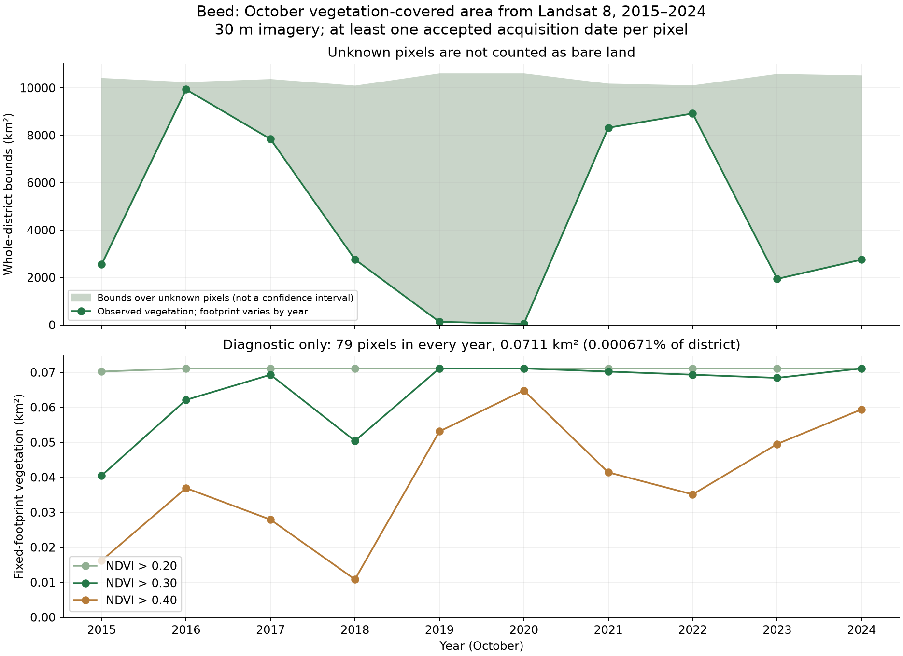
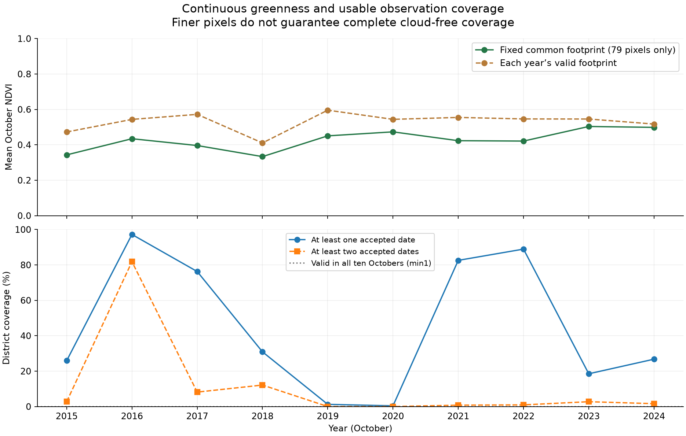
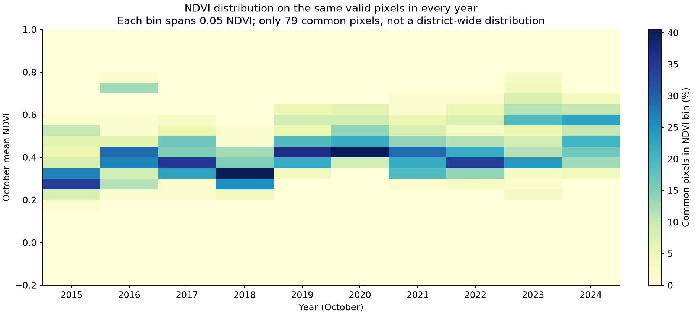
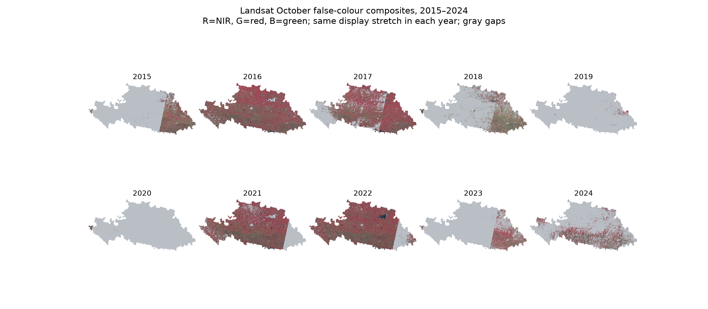
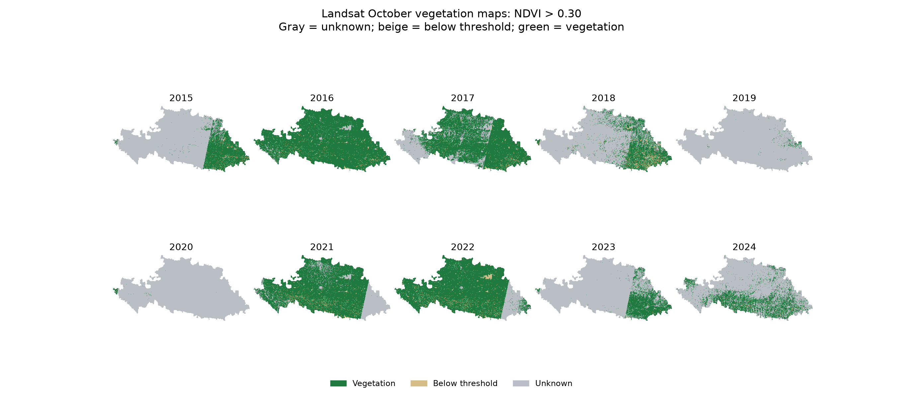
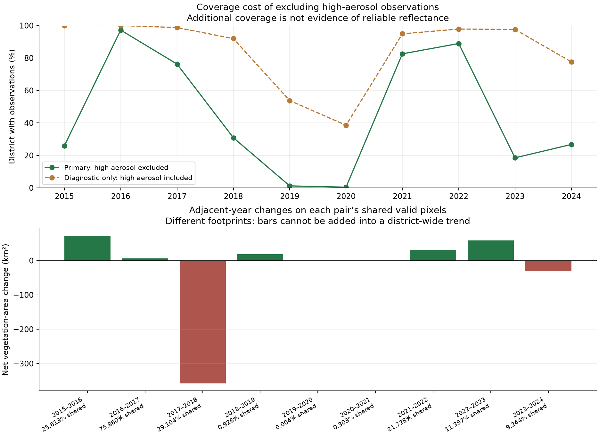

# Landsat refinement: Beed October vegetation cover, 2015–2024

## Execution and direct answer

Downloaded **67 Landsat 8 scenes**, cropped into **573 native-grid tiles** (6.05 GB of local source TIFFs). Every tile contains seven surface-reflectance bands including NIR/SWIR plus three quality bands. All ten October years have been processed locally at **30 m**. Original MODIS outputs are preserved.

**A district-wide ten-year Landsat trend is not supported by these data.** Only **79 pixels**, covering **0.0711 km² (0.000671% of Beed)**, pass the fixed quality rule in every October. This tiny selected footprint is unsuitable for a district-level trend conclusion.

For reproducibility only, with **NDVI > 0.30**, that tiny footprint has **4 decreases and 4 increases and 1 unchanged transition(s)** across nine transitions. The descriptive slope is **+0.002296 km²/year**. These are observations, not significance or causal drought claims.

The all-year valid footprint is **0.0711 km² (0.000671% of the mapped district)**. Valid annual coverage ranges from **0.4% to 97.2%**. This selected footprint is not a random district sample; its trend must not be extrapolated to missing pixels. Compare the fixed footprint rather than mistaking changing cloud gaps for area change. If this common fraction is small, the ten-year Landsat slope describes only that small selected area and is not evidence of district-wide improvement or decline.

**Role in the submission:** retain the MODIS result as the broader-coverage historical baseline. Use Landsat for finer spatial evidence in adequately observed years and an explicit coverage/quality comparison. A severely restricted ten-year Landsat footprint must not replace the MODIS series as a district-wide conclusion.

## What the finer-resolution analysis adds

The native Landsat grid resolves 30 m cells versus approximately 463 m in the MODIS baseline. It can separate some land-cover mixtures hidden within a coarse cell; it does not provide field verification. Landsat also supplies fewer observation opportunities within October, so spatial detail and temporal coverage must be considered separately. No declining trend is assumed in advance.

On these **79 selected pixels only**, mean NDVI is lowest in **2018 (0.333)**, and highest in **2023 (0.504)**. Continuous NDVI and its distribution retain variation that a binary threshold may miss. This is greenness, not a direct yield or water-deficit measurement, and it must not be interpreted as a district-wide ranking of drought years.

## Actual annual values

| Year | Valid district % | Observed vegetation km² | Fixed-footprint vegetation km² | Fixed-footprint vegetation % | Fixed-footprint mean NDVI |
| --- | ---: | ---: | ---: | ---: | ---: |
| 2015 | 25.9 | 2549.8 | 0.0405 | 57.0 | 0.343 |
| 2016 | 97.2 | 9932.6 | 0.0621 | 87.3 | 0.434 |
| 2017 | 76.3 | 7840.1 | 0.0693 | 97.5 | 0.396 |
| 2018 | 30.9 | 2759.1 | 0.0504 | 70.9 | 0.333 |
| 2019 | 1.2 | 129.4 | 0.0711 | 100.0 | 0.451 |
| 2020 | 0.4 | 42.9 | 0.0711 | 100.0 | 0.473 |
| 2021 | 82.6 | 8317.5 | 0.0702 | 98.7 | 0.423 |
| 2022 | 88.9 | 8919.9 | 0.0693 | 97.5 | 0.421 |
| 2023 | 18.5 | 1938.9 | 0.0684 | 96.2 | 0.504 |
| 2024 | 26.8 | 2750.8 | 0.0711 | 100.0 | 0.498 |

Observed vegetation uses each year's valid pixels and is a lower bound under this classification. The upper bound adds unknown area; these bounds are not confidence intervals. Fixed-footprint columns use exactly the same eligible 30 m pixels in every year.

## Method and course restriction

Source: [USGS Landsat 8 Collection 2 Tier 1 Level 2](https://developers.google.com/earth-engine/datasets/catalog/LANDSAT_LC08_C02_T1_L2). All October scenes intersecting the official Beed polygon were included; scene-wide cloud percentages were not used to discard data. Seven optical bands and QA were downloaded in tiles using Earth Engine's image-download endpoint. No server-side index, monthly composite, classification or area reduction was used.

Reflectance is **DN × 0.0000275 − 0.2**. The offset is applied before calculating **(NIR − red)/(NIR + red)**; omitting it would give a different NDVI. Reject fill, dilated cloud, cirrus, cloud, shadow, snow, optical saturation, terrain occlusion and high-aerosol flags. Aerosol climatology/interpolated values are retained and separately counted in QA records. Require valid spectral DNs, red/NIR reflectances in [0,1], and a positive denominator. The full predetermined rule is in [protocol.md](protocol.md).

Handwritten scalar loops implement the coordinate projection, scanline polygon mask, QA, reflectance conversion, NDVI, accumulation, classification and area counting. A small C++ kernel compiles those loops for speed; it calls no image-analysis or statistical library. Rasterio performs image I/O, NumPy stores arrays, and Matplotlib displays results. The native UTM grid alignment of all scenes is checked; no input resampling is performed. Pixel-centre inclusion and projected 900 m² cell areas introduce normal boundary/map-scale approximations.

Each pixel is counted at most once per acquisition date. Overlapping same-date scenes use the first valid sample in sorted scene-ID order. October NDVI is the arithmetic mean of accepted dates, not a daily time-weighted average. One accepted date is sufficient for the primary result; coverage with two dates is shown separately. All-year common min2 coverage is recorded in computation provenance.

Valid water pixels remain eligible here, whereas MODIS QA excluded non-land. Sensors also differ in observation dates, spectral response, QA and their all-year valid footprints. Differences between their district summaries cannot therefore be attributed solely to resolution or treated as a classification-accuracy score.

## Sensitivity on the tiny common footprint

These numerical results describe only 79 pixels. They are retained for reproducibility, not used for a district-wide trend claim.

| Threshold | OLS km²/year | Median pairwise slope km²/year | Decreasing transitions / 9 |
| --- | ---: | ---: | ---: |
| 0.20 | +0.000049 | +0.000000 | 0 |
| 0.30 | +0.002296 | +0.000900 | 4 |
| 0.40 | +0.003736 | +0.004162 | 4 |

Thresholds were fixed before interpreting the results. NDVI is a greenness proxy; these are whole-pixel classification areas, not fractional canopy cover. A one-month annual series cannot separate drought from crop timing, harvest, irrigation or land-use change. The prior official drought records establish Beed's suitability as a study location; they do not validate individual Landsat classes.

## Quality limitations and pairwise spatial changes

| Year | Primary valid district % | If high aerosol admitted % (diagnostic only) |
| --- | ---: | ---: |
| 2015 | 25.9 | 99.9 |
| 2016 | 97.2 | 100.0 |
| 2017 | 76.3 | 98.7 |
| 2018 | 30.9 | 91.9 |
| 2019 | 1.2 | 53.8 |
| 2020 | 0.4 | 38.6 |
| 2021 | 82.6 | 94.9 |
| 2022 | 88.9 | 97.8 |
| 2023 | 18.5 | 97.6 |
| 2024 | 26.8 | 77.6 |

An initial 2015 audit found that the high-aerosol exclusion removes much of the otherwise eligible imagery. The primary rule was retained. The diagnostic above measures possible coverage if that exclusion were removed, keeping other quality/physical checks fixed; these extra pixels are **not** used for the primary vegetation estimates. [USGS cautions against high-aerosol pixels](https://www.usgs.gov/landsat-missions/landsat-collection-2-surface-reflectance) and documents [atmospheric-correction issues](https://www.usgs.gov/landsat-missions/landsat-collection-2-known-issues). Admitting them would raise the all-year common footprint to 13.4%, but that coverage is not established-quality evidence.

| Years | Shared district % | Vegetation gain km² | Vegetation loss km² | Net change km² |
| --- | ---: | ---: | ---: | ---: |
| 2015–2016 | 25.6132 | 150.9048 | 79.2279 | +71.6769 |
| 2016–2017 | 75.8596 | 109.9152 | 104.0922 | +5.8230 |
| 2017–2018 | 29.1045 | 47.9178 | 406.2087 | -358.2909 |
| 2018–2019 | 0.9256 | 18.3177 | 0.1701 | +18.1476 |
| 2019–2020 | 0.0045 | 0.0045 | 0.0090 | -0.0045 |
| 2020–2021 | 0.3029 | 0.2277 | 0.7596 | -0.5319 |
| 2021–2022 | 81.7277 | 179.4510 | 148.9626 | +30.4884 |
| 2022–2023 | 11.3969 | 60.9003 | 2.3904 | +58.5099 |
| 2023–2024 | 9.2438 | 3.0375 | 33.9606 | -30.9231 |
| 2015–2024 | 10.2558 | 74.1564 | 31.2435 | +42.9129 |

These pairs use only pixels observed in both named years, rather than requiring all ten years. This retains more locations for individual comparisons, but each pair has a different spatial population. Gains and losses are threshold crossings, not independently verified conversion of land cover. Do not add pairwise net changes together or extrapolate them to the district.

## Verification and outstanding scientific work

All 573 source hashes and grid checks passed. Five algorithm tests passed, including reflectance offset, cloud/saturation screening, same-date deduplication and unknown-pixel treatment. An independent Python implementation reconstructed **1050 sampled pixel-year histories** from downloaded scene values and matched the calculated NDVI, date counts and classes. The main spatial sample was chosen without selecting on greenness or clear status; up to ten additional common-valid pixels ensure that observed values are checked in every year. These checks establish computational consistency, not field accuracy.

**Independent vegetation reference labels are still needed before claiming classification accuracy or an ML improvement.** Finer-resolution imagery is an improvement in spatial evidence, not a substitute for those labels. A supervised comparison must keep reference-label creation independent of the NDVI threshold and reserve spatially separate test locations. No ML model or drought forecast has been trained in this stage.

Reproduction: [pipeline instructions](../../pipeline/landsat/README.md). Source IDs, tile coordinates, dates and checksums are retained in `data/landsat/inventory.json` and `download_manifest.json`. Large TIFFs remain local and ignored by Git. Processed NDVI, seven-band composites, classes and unique-date counts are in `data/landsat/processed/`. The primary numerical table is [annual_vegetation.csv](annual_vegetation.csv).
