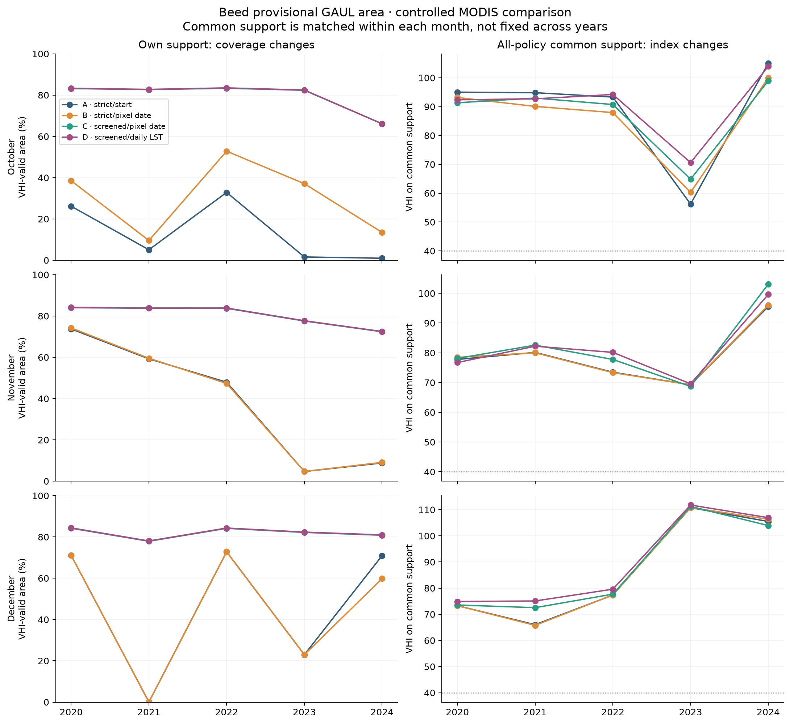
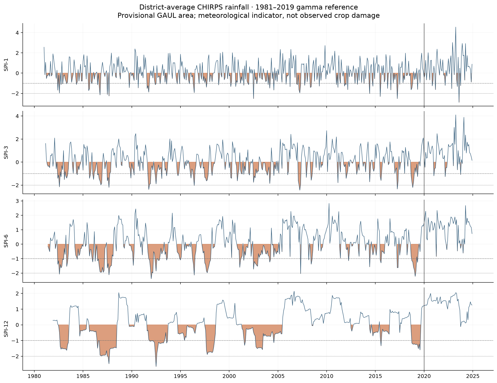
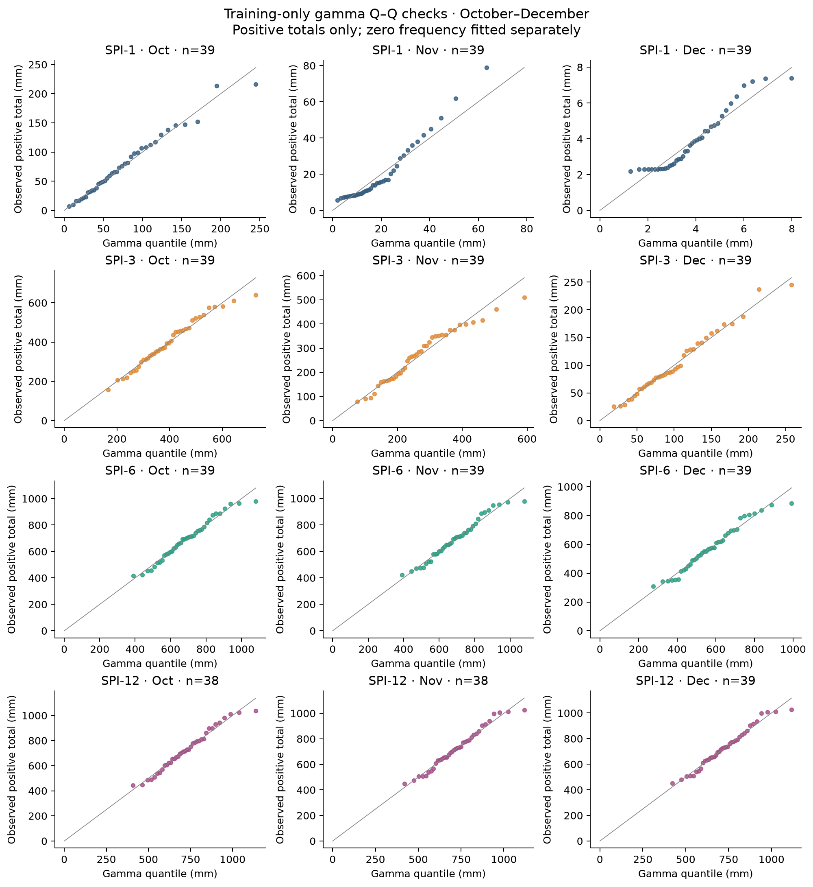
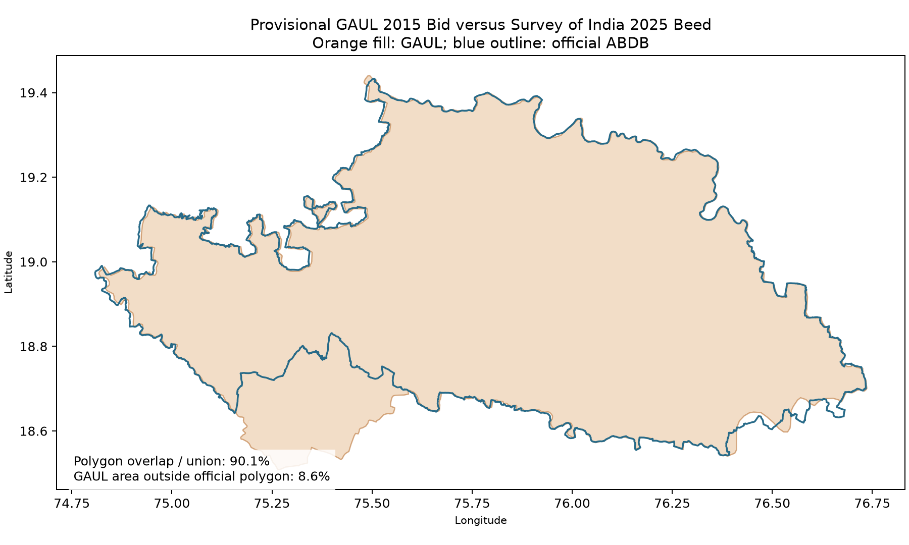
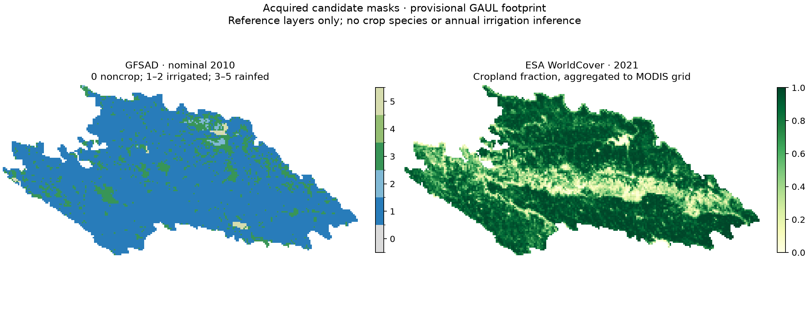

# Executed controlled reconstruction: findings and limits

Completed 6 November 2026, using authenticated Earth Engine project `weighttrack-493810`.
The satellite comparison, historical coverage reconstruction and rainfall/SPI analysis
have actually executed. The main finding is a large sensitivity of valid coverage to
the NDVI quality policy, alongside a material geographical mismatch that prevents
interpreting this run as a validated current-Beed crop-impact assessment.

All **936 real rows** are in [data/study](../../data/study/): 120 comparison rows,
288 historical policy rows and 528 monthly rainfall rows. The three monolithic Drive
jobs were submitted, but the comparison ran for an extended period and retried while
the other jobs queued. The same calculations were successfully retrieved through the
official `ee.data.computeFeatures` API in small checkpointed requests. Only after
validation were the three redundant batch jobs cancelled. These are completed Earth
Engine computations and local CSV downloads, not completed Drive batch exports.

[Execution manifest](execution_manifest.json) records row counts, hashes and retrieval
times. Each raw CSV has a provenance sidecar; 131 request checkpoints and the exact
submitted/direct Python source snapshots are retained. Earlier project work and the
original JavaScript experiment remain intact.

All 12 tests passed. The live strict A/October/2020 preflight reproduced **VHI
91.427477222441**, valid fraction **0.2617443143005018**, and MODIS-grid area
**11,412.55645769558 km²** exactly. All five earlier October A VHI and coverage
values, October rainfall totals and August–October rainfall totals also match.
Historical A/B October coverage agrees with the independent audits, C/D NDVI agrees,
and all screened October coverage lies within the previously derived set bounds.
See [cross-run validation](cross_run_validation.json).

The primary experiment uses the same provisional GAUL 2015 polygon, 2001–2019
calendar-month references, at least 15 reference years and unmodified index formulas.
A uses composite start dates and strict QA; B uses selected-pixel NDVI dates; C adds
the explicitly screened marginal NDVI observations; D changes C's LST to strict-QA
daily MOD11A1. D–C is a product/aggregation comparison, not a pure timing effect.

**October VHI-valid coverage, percentage of the provisional district:**

| Year | A strict/start | B strict/pixel date | C screened | D screened/daily LST |
| --- | ---: | ---: | ---: | ---: |
| 2020 | 26.17 | 38.50 | 83.16 | 83.31 |
| 2021 | 5.08 | 9.58 | 82.64 | 82.77 |
| 2022 | 32.86 | 52.83 | 83.32 | 83.49 |
| 2023 | 1.60 | 37.10 | 82.32 | 82.47 |
| 2024 | 0.97 | 13.51 | 66.09 | 66.13 |

C's current October NDVI coverage is 88.27%, 86.48%, 88.12%, 84.77% and 69.01%,
respectively. These are NDVI footprints, not VHI footprints: reference eligibility
and LST reduce final VHI support. Screened current NDVI includes the strict
pixel-date observations; rebuilt reference spans mean final VHI eligibility need not
be spatially nested. The median VHI-valid coverage across all 15 evaluation months
is 26.17% for A, 38.50% for B, 82.64% for C and 82.77% for D.

The coverage gain is real, but it is not evidence that screened observations are
more accurate or that the newly covered area is drought-free. The marginal-policy
choice still needs independent validation. December 2021 is especially stark:
A/B cover only **4.28 km² (0.0375%)**, while C covers 77.91%. A district mean from
the former footprint is not representative evidence for district conditions.

On each month's all-variant common support, B–A VHI changes range from −5.36 to
+4.06 points, C–B from −2.39 to +7.10, and D–C from −3.47 to +5.76. These isolate
policy effects more cleanly than own-support means, but common support can be tiny:
only **1.60% in October 2023** and **0.64% in October 2024**. It also changes between
months and years. Neither the own-support means nor these five-year curves establish
a land-condition trend.

The largest pairwise class disagreement with A is 19.89% for D in October 2023,
measured on overlap covering just 1.60% of the district. It must not be reported as
19.89% of the district changing class. Unknown pixels remain unclassified.

Out-of-reference values are substantial. In October 2024, **67.74% of A's valid
footprint** and **42.35% of C's** have VHI outside [0,100]. Values remain unclipped;
the class bin ≥40 includes values above 100. Across all 15 months C's outside-range
fraction reaches 72.92%. Thus a high VHI or the literature label “no drought” is not
an independently calibrated statement about crop outcomes. Mean NDVI reference spans
on C's own support range from 0.238 to 0.262; mean LST spans from 6.78 to 9.74 K.
These exported means do not reveal the entire distribution of small pixelwise spans.

D averages **7.99–22.91 accepted daily LST observations per pixel** on its valid
support, depending on month. The primary minimum remains one accepted observation;
the means do not guarantee adequate support at every pixel. Clear-sky sampling and
monthly minimum-count sensitivity remain issues for a follow-up reconstruction.

All 528 rainfall months have complete daily counts and full area coverage. All 48
calendar-month/timescale gamma fits succeeded, with 38–39 reference totals and no
probability clipping. SPI here is calculated from district-average rainfall, not
averaged from pixelwise SPI. Fitting stops in 2019.

| October | Rainfall (mm) | SPI-1 | SPI-3 | SPI-6 | SPI-12 |
| --- | ---: | ---: | ---: | ---: | ---: |
| 2020 | 148.63 | 1.27 | 1.17 | 1.59 | 1.54 |
| 2021 | 84.24 | 0.38 | 1.04 | 1.48 | 1.35 |
| 2022 | 189.27 | 1.72 | 1.44 | 1.89 | 1.79 |
| 2023 | 20.66 | −1.24 | −1.09 | −0.29 | −0.12 |
| 2024 | 85.54 | 0.40 | 0.72 | 1.23 | 1.46 |

October 2023 shows a short-accumulation rainfall deficit under this specification;
the longer accumulations are much closer to normal. This is not a crop-damage
estimate. The [evaluation-season CSV](evaluation_season_spi.csv) contains all
October–December values, and [rainfall_spi.csv](rainfall_spi.csv) the full record.

Gamma Q–Q inspection flags the November and December SPI-1 shapes for caution.
A refit-parametric-bootstrap KS check with 1,999 replicates (seed 605) gives raw
p=0.004 for November SPI-1 and p=0.031 for December SPI-1; January SPI-1 is also
flagged at p=0.003. None falls below 0.05 after Holm correction across the 48 fits
(minimum adjusted p=0.144). This is **not proof of gamma adequacy**: the samples are
small, the check addresses only positive totals, and it does not validate rare tails
or account for possible interannual dependence. October's four positive components
show no conspicuous Q–Q mismatch. See [fit review](spi_gamma_fit_review.csv).

The exploratory rainfall trend calculation gives JJAS Sen slope +4.77 mm/year
(conventional interval +0.92 to +8.10), Kendall tau 0.247 and independence-based
p=0.018 over 44 years. OND gives +0.93 mm/year (−0.21 to +2.21), tau 0.178,
p=0.089. Lag-one correlations are 0.197 and −0.124. These trend tests have not been
adjusted for serial dependence or multiple trend comparisons; they do not establish
a settled climatic trend. Their methodology is separate from the Holm correction
used for the gamma-fit diagnostics.

The authoritative boundary check is a substantive limit on interpretation.
[Survey of India ABDB](https://surveyofindia.gov.in/pages/administrative-boundary-data-base-abdb-)
provides district boundaries with 2025 Maharashtra harmonization to ORGI, published
6 May 2026. The archive, metadata and extracted Beed geometry (LGD 523) were
downloaded. Equal-area polygon calculations give:

| Boundary metric | Result |
| --- | ---: |
| GAUL 2015 polygon area | 11,413.59 km² |
| SOI 2025 Beed polygon area | 10,603.22 km² |
| Intersection | 10,436.06 km² |
| GAUL outside SOI Beed | 977.53 km² (8.56% of GAUL) |
| SOI Beed omitted by GAUL | 167.17 km² (1.58% of SOI) |
| Intersection / union | 90.12% |

About 896.87 km² of GAUL overlaps present-day Ahilyanagar; smaller differences involve
other neighboring districts. Polygon areas above use EPSG:6933 and differ from
native-grid raster area sums. The [district website](https://beed.gov.in/en/) lists
10,693 km², which also differs from the downloaded SOI polygon. Neither a rounded
published area nor a current boundary establishes the correct historical footprint
for every year of the analysis. The current controlled experiment therefore retains
its explicit GAUL footprint and does not silently substitute a new geometry.

Two candidate rasters were acquired and inspected: [ESA WorldCover v200](https://developers.google.com/earth-engine/datasets/catalog/ESA_WorldCover_v200)
2021 cropland fraction, aggregated from 10 m via a 100 m intermediate to the MODIS
grid; and [USGS GFSAD1000](https://developers.google.com/earth-engine/datasets/catalog/USGS_GFSAD1000_V1)
nominal-2010 crop/irrigation classes, sampled to the MODIS grid. Both are 112×233
pixels with 13,865 non-nodata pixels inside the provisional footprint. Cropland
fractions lie in [0,1]; GFSAD classes lie in [0,5]. The masks have not been applied to
the primary experiment. GFSAD inputs date from 2007–2012 and provide neither crop
species nor annual 2020–2024 irrigation status.

The Maharashtra Agriculture Department's [official APY listing](https://krishi.maharashtra.gov.in/Site/Common/ViewGr.aspx?Doctype=01ce19af-d065-4817-ac1a-71c1c0f8874d)
supplied **25 annual PDFs, 2000–01 through 2024–25**. Raw extraction retained 1,323
Beed source rows, including crop totals, with file/page references, source titles,
original units and footnotes. Thirty-two ambiguous merged cells were excluded and
logged instead of guessed. This is an acquired and partially checked source table,
not a fully harmonized crop-yield panel. Cotton production uses 100 bales of 170 kg
in the inspected current table; sugarcane yield uses tonnes/ha, unlike the kg/ha
header for other crops. Source estimates and agricultural-year labels must be
retained when harmonizing. The 2022–23 sugarcane/cotton page was visually checked.

Independent impact agreement and ML were deliberately not evaluated: the current
satellite footprint and official district yield denominator do not match, crop species
and annual irrigation are unresolved, and 2014/2015 vegetation history lies within
the 2001–2019 reference. A defensible next experiment must choose and document a
boundary appropriate to the intended historical/current question, rerun indicators
on that geometry and crop support, assess daily LST thresholds and gamma sensitivity,
harmonize the crop panel, then define held-out impact targets and simple baselines.
No novelty, forecasting skill, crop damage or land-degradation claim follows from
this execution alone.
